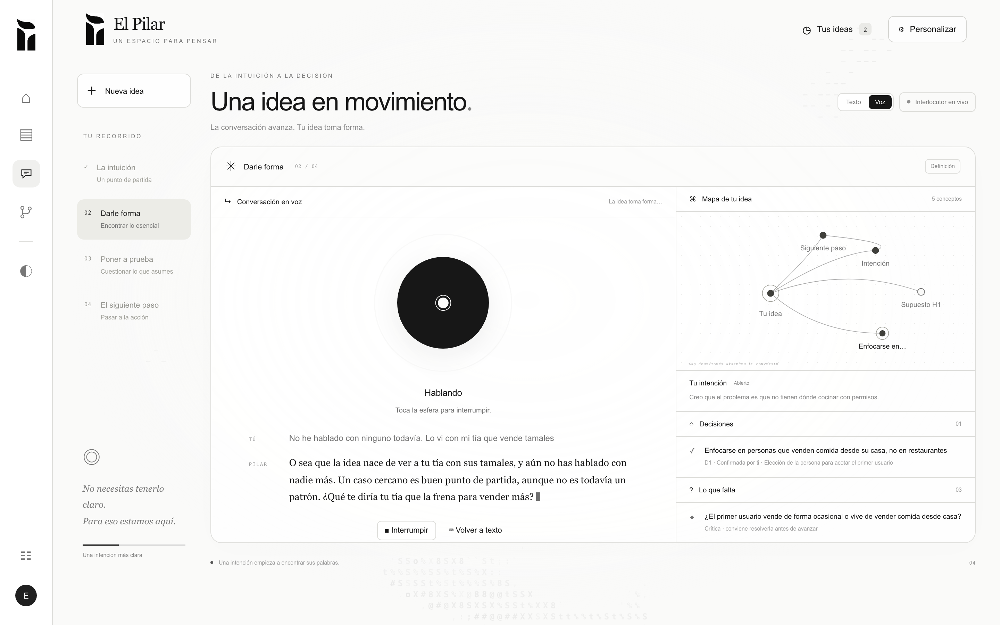
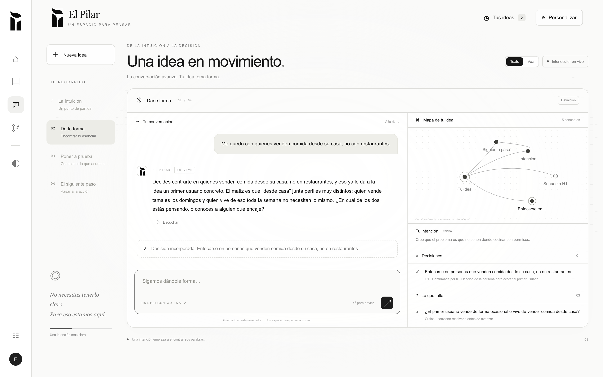
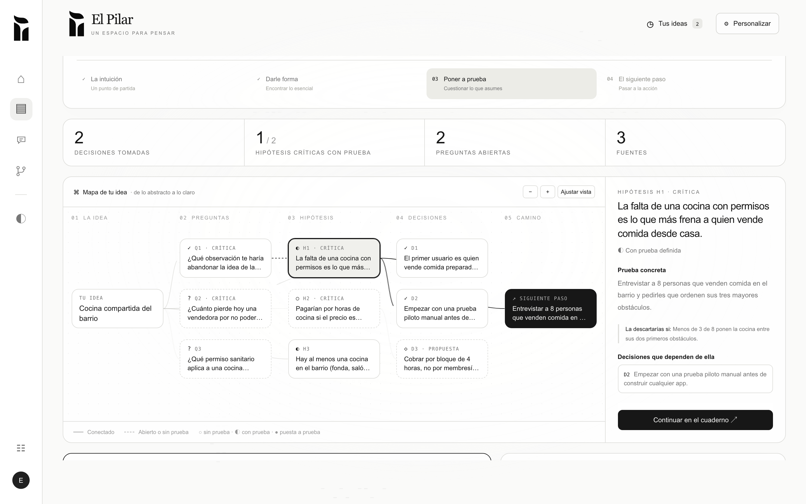

# El Pilar: think out loud until the idea exists

**Hacktoberfest México 2026 · MLH · Best Use of ElevenLabs · Best Use of Firecrawl**

> *De la intuición a la decisión.* El Pilar is a space to think. You talk with **Pilar**, an AI interlocutor that questions your idea instead of applauding it. While you talk, she builds a living model of your idea: decisions, hypotheses, open questions and a concrete next step.



## The problem

People with an idea (a software architect, a researcher, a student, a founder) talk to a chatbot to make it clearer, and end up with an endless scroll. They lose the thread, they can't tell whether they're done or just tired, and the assistant tends to agree with everything.

## The idea

Pilar is an **interlocutor, not a ghostwriter**. Her job is to help the idea take shape, not to word it nicely:

- **One good question at a time.** No walls of text.
- **No flattery.** She objects once, with a reason, then respects your decision. She never says an idea "is validated" or "will work".
- **Scientific method.** She separates what you claim from what is proven. Every important assumption becomes a hypothesis with a test and a refutation condition written in advance.
- **Your judgment rules.** Pilar proposes; you decide what goes into the model of your idea.
- **A stopping criterion.** An idea is ready to validate when no critical question is open and every key hypothesis has a concrete way to be checked. "Ready" does not mean "true".

The journey has four stages, shown live: **La intuición → Darle forma → Poner a prueba → El siguiente paso**.

## How we use ElevenLabs: Pilar has ears and a voice

Thinking out loud is literal here. ElevenLabs is the whole voice loop, not a "read aloud" button.

| | ElevenLabs API | What it does in El Pilar |
|---|---|---|
| 👂 Ears | **Speech to Text** (`scribe_v1`, Spanish) | Voice mode records you; when you stop talking (voice activity detection, ~1.3 s of silence) the audio goes to `/api/stt` and comes back as your turn. ~0.3–0.8 s per utterance. |
| 🗣️ Voice | **Text to Speech streaming** (`eleven_flash_v2_5`, Mexican Spanish voice) | Pilar's reply is spoken **sentence by sentence while the LLM is still streaming**, so she starts talking ~0.2 s after the first sentence exists. |
| ☎️ Phone | TTS audio played inside a **Twilio** call | "Llamarme": Pilar calls your phone and keeps the conversation there, with her ElevenLabs voice, while the web page updates live. |

Voice mode replaces the chat column with a listening / thinking / speaking orb and live captions. **Everything else stays identical**: the same brain, the same idea map, decisions and hypotheses updating as you speak. You can switch between text and voice at any moment without losing the conversation. In voice mode Pilar answers shorter and in natural spoken Spanish.

Measured latency (venue wifi): speech-to-text 0.3–1.6 s, transcript to first audio 2.5–3.1 s.

## How we use Firecrawl: Pilar contrasts your idea with the world

An idea checked only against what its owner believes is not checked. **Firecrawl gives Pilar eyes outside the conversation.**

- **Today (working):** in the chat you paste a URL in "Agregar fuente". The server calls Firecrawl `/v2/scrape` (main content only, as markdown), keeps the title and a clean excerpt, and adds it as a source of the idea. From then on the source is part of Pilar's context, so she uses it to confirm, contradict or leave open your assumptions. The Firecrawl key never reaches the browser.
- **The goal:** every critical hypothesis is linked to the sources that support or refute it, and the panel shows which assumptions still have **no evidence**. Sources include PDFs and DOCX (papers for researchers, RFCs and vendor docs for architects), stored as files of the idea. Pilar suggests *which* evidence to bring when a claim needs it; the person decides what goes in.

## Real cases (in the app)

The chat opens with real conversations recorded against the live engine, cut mid-process so you can continue them live:

| Context | Case |
|---|---|
| Industry · Software architecture | From a payments monolith to services: build vs buy, a latency hypothesis at 300 payments/s |
| Industry · Product · MVP | Payroll export MVP: first customer, out of scope, a refutable metric |
| Industry · Technical strategy · AI | AI in customer support: a pilot with kill criteria |
| Academic · Student | Understanding Bayes for a final project |
| Academic · Research | Food delivery and ultra-processed food in university students |
| Academic · Thesis | Master's thesis: LLMs and feedback for programming students |
| Everyday · Entrepreneurship | Home-made mole in jars |

| | |
|---|---|
|  |  |

## What's in the app

- **Inicio**: "¿Qué tienes en mente?"
- **Cuaderno (`/chat`)**: text or voice conversation with Pilar, plus the live idea map, decisions, open questions, hypotheses, sources and next step.
- **Tus ideas (`/dashboard`)**: each idea's journey: "Empezó como → Hoy es", the map, and what is still missing.
- **Decision Lab (`/lab`)**: compare 2–5 alternatives side by side before choosing.
- **Llamarme**: continue the conversation over a phone call (Twilio + ElevenLabs).

## Stack

Next.js 16 (App Router), React 19, TypeScript. Claude (Anthropic API, streaming) as the brain; ElevenLabs (STT + streaming TTS) as ears and voice; Firecrawl for sources; Twilio for phone calls. API keys live only on the server. No database: ideas live in the browser for this prototype.

## Run it

```sh
pnpm install
cp .env.example .env.local   # ANTHROPIC_API_KEY, ELEVENLABS_API_KEY, FIRECRAWL_API_KEY
pnpm dev                     # http://localhost:3100
```

Then open `/chat`, pick a real case on the left, or switch to **Voz** and talk. Full technical reference (API routes, engines, fallbacks, Railway deploy, phone setup): [`docs/TECNICO.md`](docs/TECNICO.md).

## Honest status

This is a hackathon prototype built in one day. The example ideas are preloaded fixtures, and conversations are stored only in the browser. Linking sources to hypotheses (the Firecrawl goal above) is designed but not built yet. Pilar never claims an idea is good: she shows what is missing before you can know.

## Credits

ASCII ocean background adapted from [stackedlol/ascii-sharks](https://github.com/stackedlol/ascii-sharks) (MIT); see `THIRD_PARTY_NOTICES.md`. Licensed under MIT.
